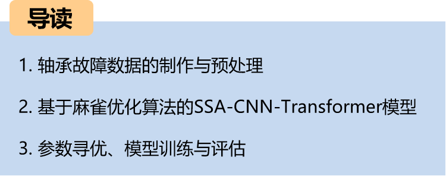
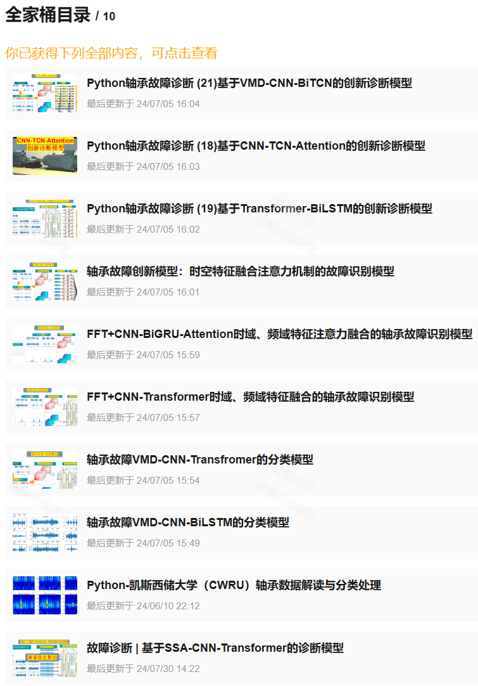
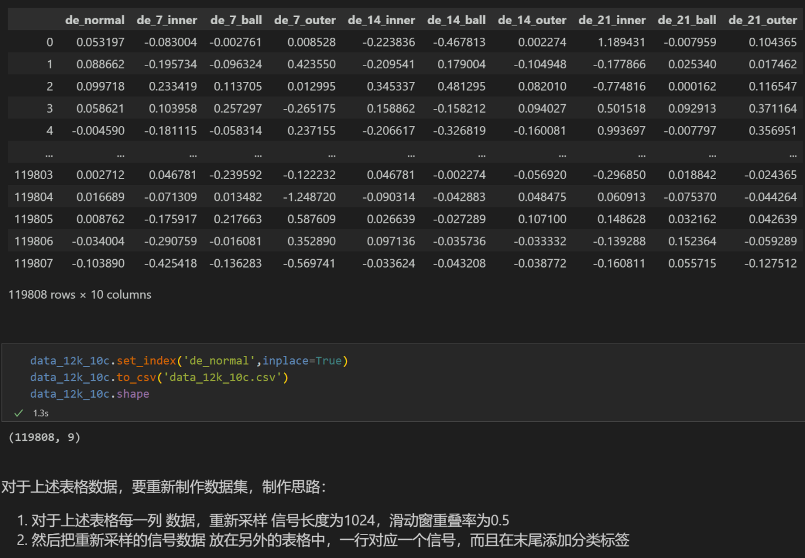
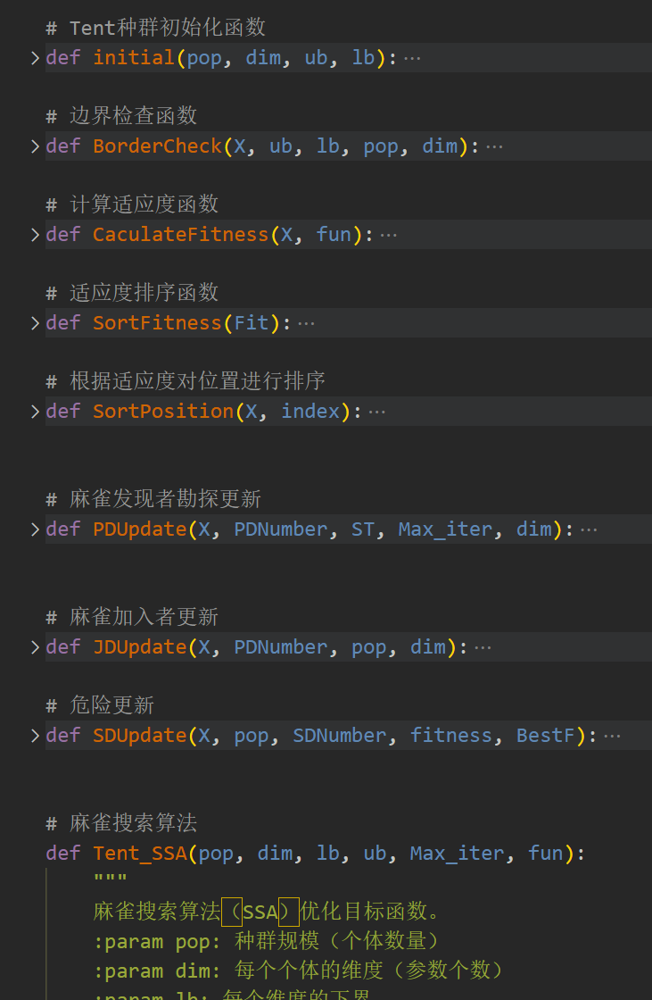
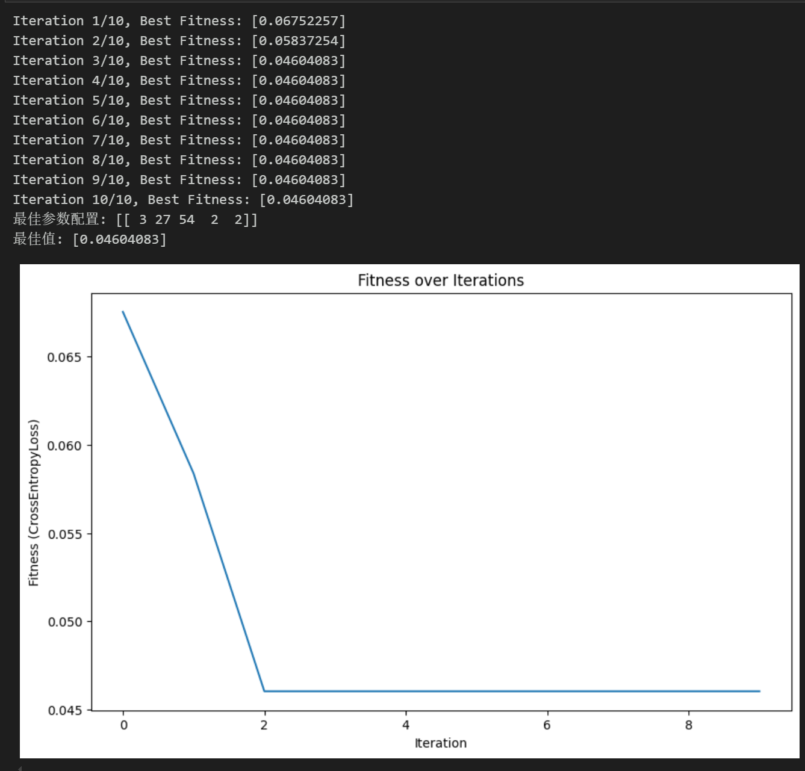
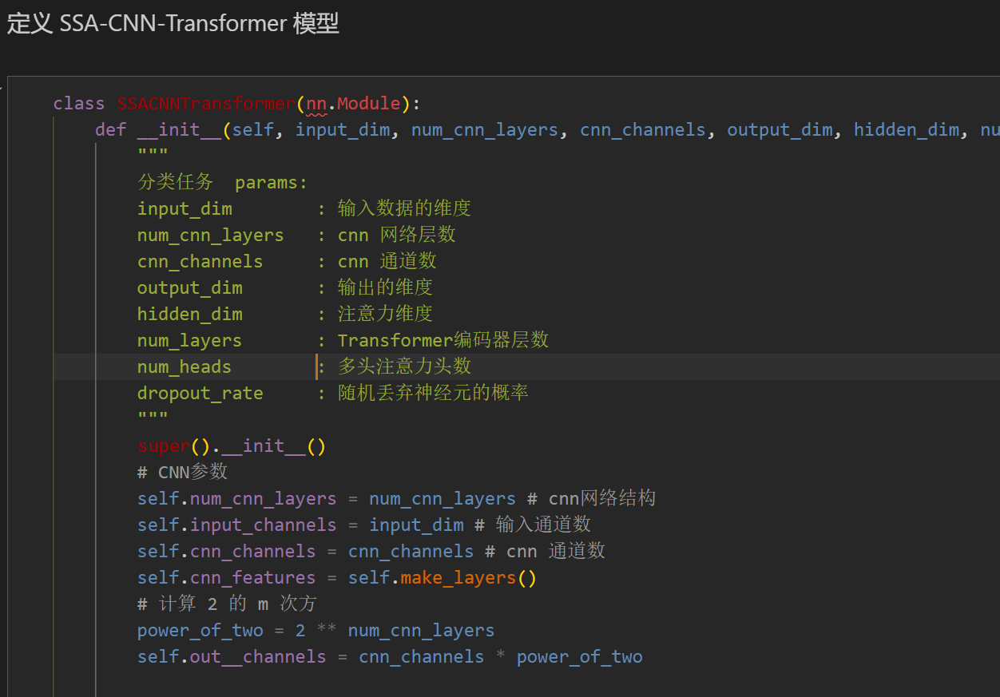
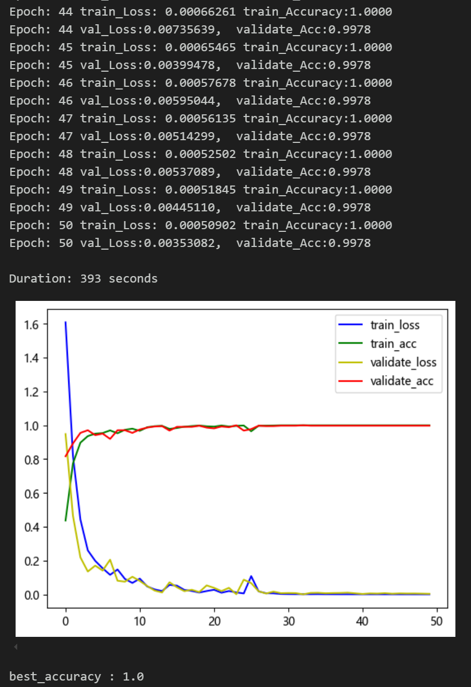
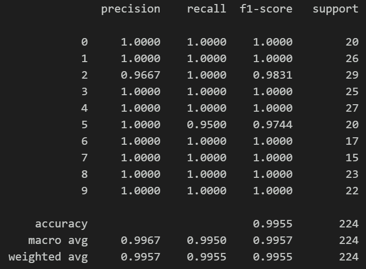
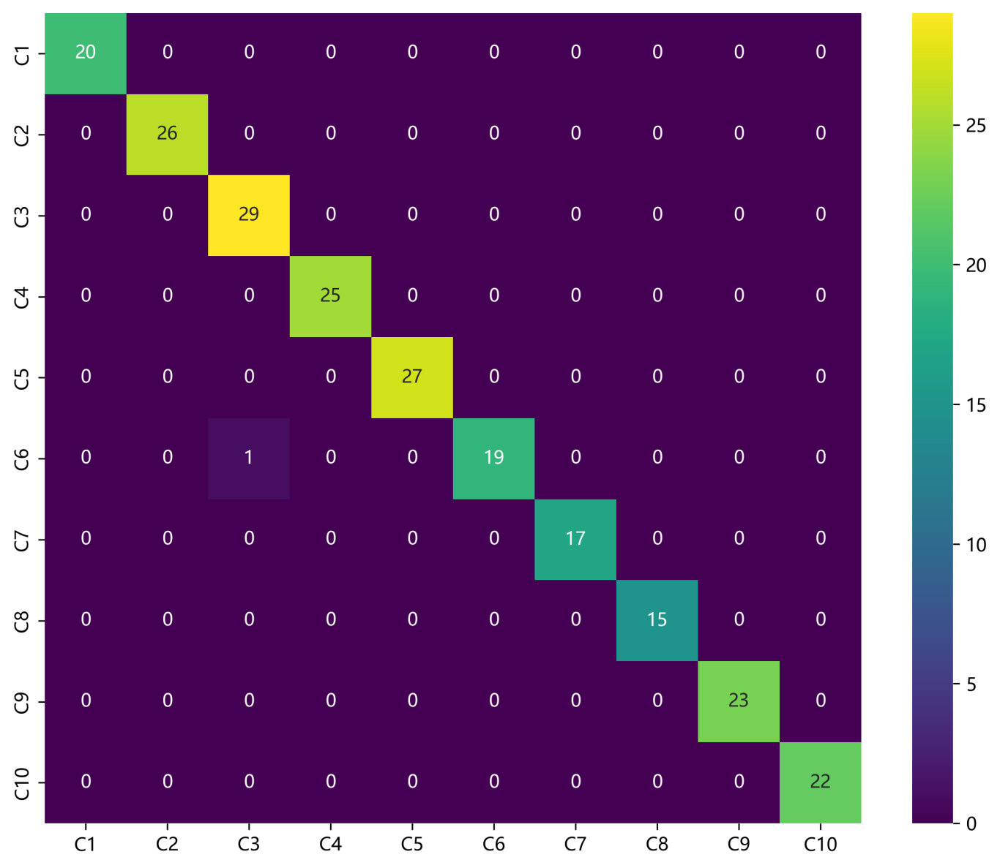
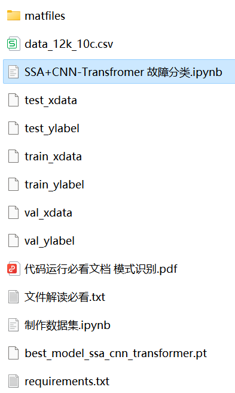

# Fault Diagnosis | Diagnosis Model Based on SSA-CNN-Transformer

1. Dataset: CWRU West Storage University Bearing Dataset
2. Environment Framework: Python 3.9, PyTorch 2.1.1 and above versions can be run
3. Accuracy: Test set 99% (CWRU)
4. Usage Objects: Paper requirements, graduation design requirements
5. Code Guarantee: The code is detailed with comments, ready to run without modification.
Preface
This article is based on the bearing data from Case Western Reserve University (CWRU), first through data preprocessing to create and load the dataset, and finally implement classification of fault data based on the SSA-CNN-Transformer model through PyTorch.
Detailed introduction to the CWRU bearing data can be found in the following article:
Python-Case Western Reserve University (CWRU) Bearing Data Interpretation and Classification Processing
1. Bearing Data Loading and Preprocessing
1.1 Import Data
Refer to previous articles for the preprocessing of fault classification with 10 categories, the CWRU bearing data 10-category dataset:
train_set, val_set, test_set are divided into 7:2:1 training set, validation set, test set, and finally save the data
The figure shows the data reading form and the preprocessing idea
1.2 Data Preprocessing, Create Dataset
3. Sparrow Optimization Algorithm
3.1 Introduction to Sparrow Optimization Algorithm
Sparrow Optimization Algorithm (SSA) is a kind of optimization algorithm based on the characteristics of bird behavior in nature, which simulates the optimization strategies of birds in foraging, migration, and social activities. This algorithm has shown good performance in solving various optimization problems.
The basic idea of the Sparrow Optimization Algorithm is to optimize the solution in the search space by simulating the foraging behavior of birds. The process can be divided into three stages: foraging behavior, migration behavior, and social behavior.
(1). Foraging Behavior: Sparrows select food sources that are closer and have higher adaptability when foraging. In the algorithm, each individual in the solution space is considered a food source with an adaptability evaluation value. Sparrows seek out better solutions by selecting individuals with higher adaptability.

(2). Migration Behavior: When sparrows search around a food source for a certain period without finding a better solution, they will choose to leave the current food source and head to other food sources to continue searching. In the algorithm, the position information between individuals will change to simulate the migration behavior of sparrows.

(3). Social Behavior: When sparrows forage, they communicate with other sparrows to obtain more information and improve their foraging efficiency. In the algorithm, individuals exchange information to improve their solutions and update the optimal solution in the solution space.

\t3.2 Python-based Sparrow Optimization Algorithm Implementation
\t3.3 Sparrow Optimization Algorithm - Parametric Optimization Process
The Sparrow Optimization Algorithm has the characteristics of simplicity, easy implementation, global optimization capability, and self-adaptability, making it suitable for solving combinatorial optimization problems. We use the Sparrow Optimization Algorithm to optimize the hyperparameters of the CNN-Transformer model.
By setting the appropriate population size and number of optimization iterations, we search for the optimal parameters within the given hyperparameter range.

\t4. Pytorch-based SSA-CNN-Transformer Novel Diagnosis Model
\t4.1 Define the SSA-CNN-Transformer classification network model
\t4.2 Set parameters and train the model
With 50 epochs and an accuracy rate of 100%, the SSA-CNN-Transformer network achieves significant classification effects. The model can fully extract multi-scale features of bearing fault signals, converges quickly, and performs exceptionally well, with noticeable results.
1. Adjustment of parameters:
- You can modify the population size and optimization iterations of the Sparrow Optimization Algorithm;
- Adjust the parameter search range for the number of layers and dimensions in CNN and Transformer, increasing more epochs (note to prevent overfitting);
- Change the shape of one-dimensional signal stacking (set appropriate length and dimension);
- Model evaluation:
- Accuracy, Precision, Recall, F1 Score
- Fault classification confusion matrix:
- Click to download: Complete original data, Python code
- Previously interesting content:
- Python - Kaiser Permanente University (CWRU) Bearing Data Interpretation and Classification Process
- Python Bearing Fault Diagnosis (I) Short-time Fourier Transform STFT
- Python Bearing Fault Diagnosis (II) Continuous Wavelet Transform CWT
- Python Bearing Fault Diagnosis (III) Empirical Mode Decomposition EMD
- Pytorch-LSTM Bearing Fault One-Dimensional Signal Classification (I)
- Pytorch-CNN Bearing Fault One-Dimensional Signal Classification (II)
- Pytorch-Transformer Bearing Fault One-Dimensional Signal Classification (III)
- Python Bearing Fault Diagnosis (IV) Based on EMD-CNN Fault Classification
- Python Bearing Fault Diagnosis (V) Based on EMD-LSTM Fault Classification
- Python Bearing Fault Diagnosis (VI) Based on EMD-Transformer Fault Classification
- Python Bearing Fault Diagnosis (VII) Based on EMD-CNN-LSTM Fault Classification
- Python Bearing Fault Diagnosis (VIII) Based on EMD-CNN-GRU Parallel Model Fault Classification
- Based on FFT + CNN - BiGRU-Attention Time-Domain, Frequency-Domain Feature Attention Fusion Bearing Fault Identification Model
Based on FFT + CNN - Transformer for Time-Domain and Frequency-Domain Feature Fusion in Bearing Fault Identification Model
Python Bearing Fault Diagnosis (IX) Based on VMD+CNN-BiLSTM for Fault Classification
Python Bearing Fault Diagnosis (X) Based on VMD+CNN-Transformer for Fault Classification
Python Bearing Fault Diagnosis (11) Based on VMD+CNN-BiGRU-Attenion for Fault Classification
Cross Attention Fusion of Time-Domain and Frequency-Domain Features with FFT + CNN-BiLSTM-CrossAttention for Bearing Fault Identification Model
Cross Attention Fusion of Time-Domain and Frequency-Domain Features with FFT + CNN-Transformer-CrossAttention for Bearing Fault Identification Model
Python Bearing Fault Diagnosis Tutorial
Python Bearing Fault Diagnosis (13) Super-strong Machine Learning Recognition Model Based on Fault Signal Feature Extraction
Python Bearing Fault Diagnosis (14) Highly Innovative Fault Recognition Model
END

## Images

<!-- PAYMENT_BLOCK -->

## Get this dataset

- Payment link (Stripe): [Buy now](https://buy.stripe.com/3cs8yP7sY87d0vu9AB)
- Payment QR code: 

<!-- /PAYMENT_BLOCK -->
